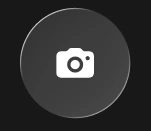
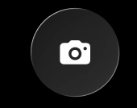
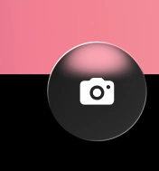
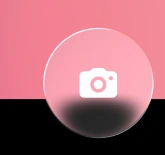
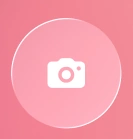

# Toolbar Liquid Glass — referencias visuales

Cinco capturas aportadas por el propietario (28-10-2026) que muestran **el mismo botón de cámara** sobre fondos y límites de color diferentes. **No son cinco diseños ni cinco estados de selección**: son pruebas del comportamiento óptico de una misma superficie translúcida. Imágenes WebP optimizadas (alta calidad, dimensiones originales conservadas), derivadas de las cinco capturas del chat.

| Captura | Fondo / situación | Qué observar |
| --- | --- | --- |
|  | Fondo gris carbón | Cuerpo gris oscuro, borde fino claro y brillo suave. |
|  | Negro uniforme | Menor iluminación aparente, contorno visible sin halo blanco artificial. |
|  | Rosa arriba / negro abajo | La luz rosa se refleja cerca del borde superior cuando el círculo atraviesa el límite. |
|  | Rosa arriba / negro abajo | La superficie deja ver/distorsiona la zona rosa con una transición oscura curva; no es un gradiente rosa permanente. |
|  | Rosa uniforme | Material más claro/rosado por la luz que hay detrás; conserva el borde y el icono blanco. |

## Referencia de origen e implementación

- Figma: [Apple Liquid Glass iOS 26 / Control Center UI Kit](https://www.figma.com/design/9M9KSCvRAbCQiAAZqxviNB/Apple-Liquid-Glass-iOS-26---Control-Center-UI-Kit----Community-?node-id=105-23). Nodo de botón de cámara: `8001:1261`; código de ejemplo `10008:89` y `10019:89` (inspeccionar el diseño y código con la conexión Figma antes de implementar).
- Referencia técnica opcional: [rdev/liquid-glass-react](https://github.com/rdev/liquid-glass-react). **No copiarlo a ciegas**: la anterior Toolbar V2 usó su motor con capas propias, quedó visualmente mal y fue eliminada.
- Punto de partida funcional: `DESIGN/shared/Toolbar.tsx` (V1). Preservar su búsqueda, sort, selección, perfil, teclado y menús. Crear una V2 aislada **solo cuando se solicite**, sin alterar V1 ni producción.
- Iconografía de destino: búsqueda `magnifyingglass`, sort `line.3.horizontal.decrease`, cancelar `xmark`, perfil `person.crop.circle` (nombres SF Symbols de referencia; no afirmar que SVGs provisionales son assets oficiales de Apple).

## Qué debe comprobar una nueva implementación

- Fondo oscuro, negro, rosa y límite rosa/negro: el **mismo componente** cambia ópticamente según el contenido detrás, no según un color de tema fijo.
- El círculo de búsqueda debe convertirse en **una única pill continua**, sin segundo disco, doble borde, rectángulo blanco de foco ni salto entre superficies.
- Select → X se ve **más oscuro cuando está activo**, con icono legible.
- Los menús sort/perfil comparten exactamente la misma geometría/anclaje y sus animaciones son fluidas.
- Inspeccionar en Chrome real (capturas y animaciones), incluida la vista móvil; no declarar igualdad visual con Apple/Figma si no está comprobada.

**Alcance:** estas capturas son referencias de diseño, no assets para incluir como fondo o botón en la aplicación. Se guardan para reutilizarlas en nuevas conversaciones.
